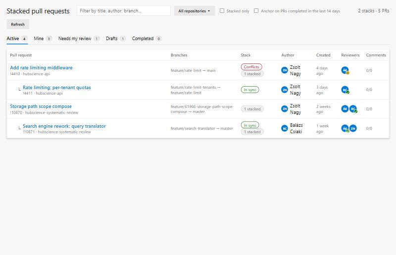
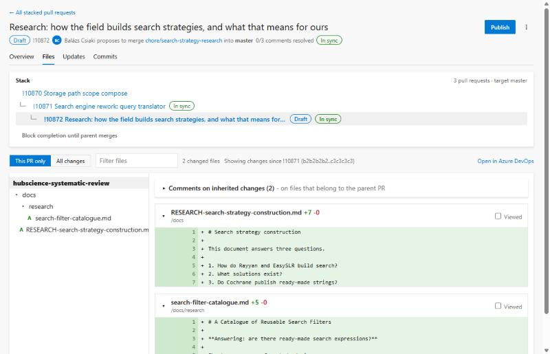
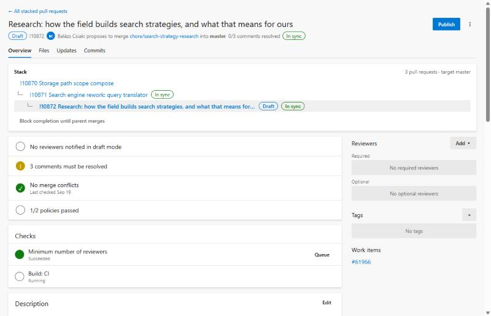

# Stacked Pull Requests for Azure DevOps

Review stacked pull requests **one layer at a time** in Azure DevOps.

When you branch `b` from `a` and open both PRs against `main`, Azure DevOps shows PR **b** with all of the changes from **a** as well. The reviewer has to read A's code again, or wait until A is merged before B becomes reviewable. This extension fixes that:

- **See the stack.** Every active PR in your project, across **all repositories**, is arranged into a hierarchy (`main ← A ← B ← C`).
- **Review only what changed.** Open any PR and switch between **This PR only** (just what this branch added on top of its parent) and **All changes** (the native view).
- **Nothing is lost.** Comments, votes, reviewers, policies and builds are the real Azure DevOps ones, so they show up in the built-in PR page and the other way round.



## Features

| | |
|---|---|
| **Stack hierarchy** | Detects stacks where B targets A's branch, and the more common case where both target `main` and B contains A's commits. Handles chains, branching stacks, and parents that were already merged. |
| **Across repositories** | One list for all repositories in the project, with a repository filter. Each repository's stacks are detected independently. |
| **Layer diff** | "This PR only" diffs the child against the merge base with its parent, so it stays correct when the parent moved on or was squash-merged. |
| **Full review** | Inline comments (reply, edit, delete, like, resolve and the other thread states), vote (approve, approve with suggestions, wait for author, reject, reset), reviewers, tags, work items, policies and build re-queue, complete / auto-complete / abandon, draft / publish, Updates and Commits tabs. |
| **Per-PR approvals** | An approval lands on the PR you are reviewing and nowhere else. Approving B does not approve A. |
| **Stack health** | Flags *parent ahead* (needs a rebase), *parent merged* (offers a one-click retarget) and merge conflicts. |
| **Merge order** | Optional status that a branch policy can require, so B cannot be completed before A. |
| **Where it lives** | A **Stacked PRs** page under *Repos*, a **Stack** tab on every PR, and an **Open stacked review** item in the PR "..." menu. |





## How stacks are detected

Highest priority first:

1. **Manual**: you pinned a parent from the PR "..." menu (stored on the PR as a property, so everyone sees it).
2. **Explicit**: same repository and `B.target == A.source`.
3. **Contained**: same repository and target, and A's commits are part of B's commit list.

If several PRs qualify, the closest one wins, so `A ⊂ A2 ⊂ B` becomes `A ← A2 ← B`. Details and edge cases are in [docs/ARCHITECTURE.md](docs/ARCHITECTURE.md).

## Install

> The extension is not published on the Marketplace yet. Publish it to your own publisher account (takes a few minutes):

```bash
npm install
# set "publisher" in azure-devops-extension.json to your Marketplace publisher id
npm run package          # builds and creates dist-vsix/*.vsix
```

Then upload the `.vsix` at <https://marketplace.visualstudio.com/manage>, share it with your organization, and install it from *Organization settings → Extensions*. See [docs/DEVELOPMENT.md](docs/DEVELOPMENT.md#publishing).

The extension requests these scopes: `vso.code_write`, `vso.code_status`, `vso.build`, `vso.work`, `vso.identity`, `vso.graph`, `vso.extension.data_write`. It talks only to your own Azure DevOps organization and has no backend.

## Using it

See the [user guide](docs/USER-GUIDE.md). In short:

1. Open **Repos → Stacked PRs**. Filter by repository, search, or use the *Needs my review* tab.
2. Click a PR. The **stack map** above the tabs shows where it sits in the stack.
3. In **Files**, choose **This PR only** to review just this layer. Click **+** next to a line to comment.
4. Vote from the header. The vote applies to this PR only.

## Limitations

These come from how Azure DevOps extensions work, not from this project:

- An extension cannot replace or modify the built-in PR page. This one adds its own full review page and links to it from the native page.
- Comments on **deleted** lines of the layer diff cannot always be placed on the same line in the native view. They are attached to the nearest remaining line and quote the removed text.
- Merge order is enforced by a branch policy that requires the optional status; nothing runs automatically in the background (no server component).
- Cloud (Azure DevOps Services) only.

## Development

```bash
npm install
npm test               # unit tests (Vitest)
npm run typecheck
npm run build
npm run dev            # HTTPS dev server on :3000 for the dev extension
```

A mock-data harness renders the real UI without Azure DevOps: `npx webpack --mode development --env harness && node scripts/serve.js`, then open <http://localhost:5173/harness.html>.

Documentation:

- [User guide](docs/USER-GUIDE.md)
- [Architecture](docs/ARCHITECTURE.md)
- [Development & publishing](docs/DEVELOPMENT.md)
- [Original design notes](docs/DESIGN.md)
- [Contributing](CONTRIBUTING.md) · [Changelog](CHANGELOG.md)

## Acknowledgements

Inspired by [Active Pull Requests](https://github.com/mimeo/vstSExtension-ActivePullRequests), which shows PRs from all repositories in one list, and by GitHub's native stacked PRs.

## License

[MIT](LICENSE)
